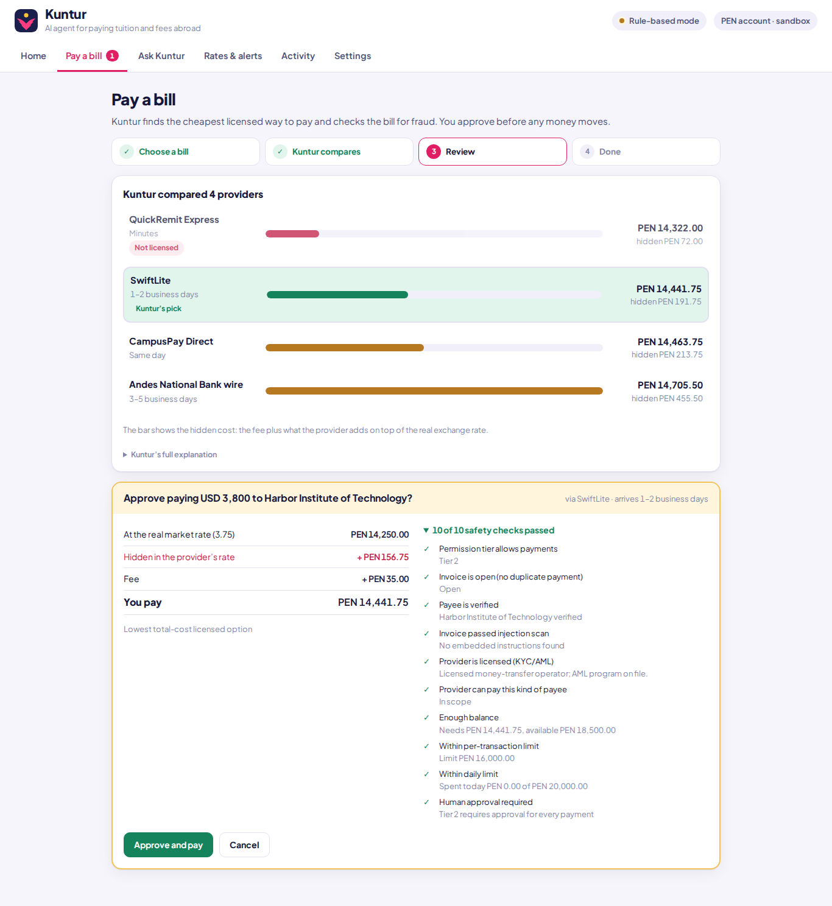

# Kuntur

**Topic C · Cross-border & Student Finance Assistant**
2026 Shenzhen International FinTechathon, International Track — theme *“AI as a Financial Participant”*.

Kuntur (Quechua for the Andean condor, a bird that crosses borders) is an AI agent that completes a real financial task end to end for an international student: it finds what is due abroad, compares transfer providers on **total** cost (FX markup + fees), refuses unlicensed providers and manipulated invoices, prepares the payment, and executes it under a permission tier the student controls.

## How the app guides the user

A three-step welcome guide (what Kuntur does → which currency you pay from → how much Kuntur may do on its own), then six clear sections: **Home** (balance, the next bill to pay, suspicious-bill warnings), **Pay a bill** (a four-step flow: choose → Kuntur compares → review → done, with a visual cost comparison and the approval card), **Ask Kuntur** (chat), **Rates & alerts**, **Activity** (timeline and downloads) and **Settings**.

## The problem

A Peruvian student paying USD 3,800 of tuition abroad typically sees only the “fee”, not the FX markup hidden in the exchange rate. In our sandbox the same payment costs between PEN 191.75 and PEN 455.50 in hidden charges depending on the provider — and the cheapest option of all is an unlicensed operator. Students also receive invoices by e-mail that may be fraudulent. An agent that just “does what the document says” is dangerous; Kuntur is built to be trusted with money.

## What the agent does

| Task | How it is completed |
|---|---|
| Find what is due | Reads invoices, flags suspicious documents |
| Choose how to pay | Quotes 4 providers; shows mid-market cost, FX markup, fee, total in PEN, speed, licence |
| Pay | Proposes a payment → deterministic policy engine → human approval (tier 2) or auto-execution under limits (tier 3) |
| Watch the market | Creates FX alerts; simulated market moves trigger them |
| Prove it | Every step goes into a SHA-256 hash-chained activity log, downloadable as a PDF report, PDF receipts, Excel-ready CSV or technical JSON |

## Documentation

- [Technical documentation: architecture, agent loop, algorithms](architecture.md)
- [Security self-assessment: permission tiers and known-risk list](security.md)
- [Testing and execution evidence](testing.md)

## Links

- Live demo: `https://YOUR-PROJECT.vercel.app`
- Source code: `https://github.com/YOUR-USER/kuntur`
- Demo video: `YOUR-VIDEO-LINK`

All accounts, payees and providers are fictional. No real money moves.
